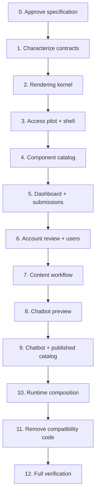

# AiCO Component-Driven Full-Stack Refactor Plan

> **Planning-first rule:** Do not refactor production code until `docs/superpowers/specs/2026-09-07-component-driven-full-stack-architecture.md` and this plan are reviewed and accepted.

**Status:** Proposed; no implementation task has started.

**Owner:** AiCO maintainers  
**Baseline source commit:** `63d07fc`  
**Existing unrelated change:** the user's staged `aico_demo_v3.html` is excluded from this plan  
**Related specification:** `docs/superpowers/specs/2026-09-07-component-driven-full-stack-architecture.md`  
**Supersedes:** Structural refactor guidance in older UI plans after this plan is accepted; completed product behavior in those plans remains current.

**Goal:** Refactor AiCO incrementally into reusable server-rendered UI modules and cohesive full-stack feature modules while preserving behavior, security, routes, and deployment.

**Architecture:** Keep Node.js/CommonJS/native HTTP. Use pure server-rendered UI components, feature-owned page compositions and client controllers, injected infrastructure adapters, and a strangler migration through compatibility exports.

**Baseline:** On 2026-09-07, `rtk npm test` passes all 200 tests.

**Coverage baseline:** 89.83% lines, 75.49% branches, and 88.54% functions using Node's native coverage.

**Tech stack:** Node.js 24, CommonJS, native `node:test`, HTML/CSS/JavaScript, PostgreSQL, Redis, Vercel, Docker Compose.

## Scope Control

- This plan changes structure, not product behavior.
- Do not introduce React, Vite, TypeScript, a template engine, Storybook, or a client state library.
- Do not change the database schema, route URLs, field names, response codes, redirect targets, roles, or publication semantics.
- Do not edit or depend on the uncommitted `aico_demo_v3.html` file.
- Do not combine a feature migration with an unrelated visual redesign.
- Keep every task deployable and keep the full suite green.

## Target Deliverables

- Shared rendering kernel and UI modules under `src/admin/ui/`.
- Feature modules under `src/admin/features/`.
- Feature-neutral guards and HTML responses under `src/admin/shared/`.
- Development-only component catalog generated into ignored `tmp/`.
- Architecture tests that enforce dependency direction.
- Removal of the `src/adminViews.js`, `src/layout.js`, and `src/admin/routes/handlers.js` monoliths after migration.
- Updated repository documentation.

## Dependency Order

## Task 0: Accept The Architecture Contract

**Files:**

- Review: `docs/superpowers/specs/2026-09-07-component-driven-full-stack-architecture.md`
- Review: `docs/superpowers/plans/2026-09-07-component-driven-full-stack-refactor.md`

- [ ] Confirm that the current server-rendered runtime remains in place.
- [ ] Confirm that feature modules, not file-per-element splitting, are the primary full-stack structure.
- [ ] Confirm that compatibility and security invariants are complete.
- [ ] Record any changed decision in the specification before implementation.
- [ ] Mark the specification accepted.

**Exit gate:** Architecture, scope, migration order, and deferred decisions are explicit; no production source has been changed.

## Task 1: Characterize Existing Interfaces And Add Architecture Guardrails

**Files:**

- Modify: `test/adminRoutesArchitecture.test.js`
- Add: `test/adminArchitecture.test.js`
- Add: `test/helpers/adminApp.js` and focused fake-adapter helpers when extracting duplicated setup
- Modify only if a missing behavior must be characterized: existing `test/*.test.js`

- [ ] Record the current public route matrix: method, path, required role, CSRF requirement, status/redirect, and response content type.
- [ ] Capture normalized renderer parity fixtures for extraction-only changes, including stable landmarks, classes, IDs, form names/actions, and client hooks.
- [ ] Add characterization tests for any route or security invariant that is relied on but not currently asserted.
- [ ] Add an architecture test helper that scans CommonJS imports.
- [ ] Assert that future files under `src/admin/ui/` cannot import feature, database, Redis, upload, auth, request, or response modules.
- [ ] Assert that future feature modules cannot import another feature's internal files.
- [ ] Keep the existing `src/adminRoutes.js` compatibility export test.
- [ ] Add a `test:coverage` command using Node's native coverage and prevent the whole-project baseline from decreasing.
- [ ] Run `rtk node --test test/adminRoutesArchitecture.test.js test/adminArchitecture.test.js`.
- [ ] Run `rtk npm test`.

**Exit gate:** Existing behavior is characterized, dependency direction can be enforced, and all tests pass.

## Task 2: Introduce The Safe Rendering Kernel

**Files:**

- Add: `src/admin/ui/html.js`
- Add: `test/adminUiHtml.test.js`
- Reuse or adapt: `src/httpUtils.js`

- [ ] Write failing tests for escaped text, attribute values, nested trusted fragments, arrays, empty values, and final serialization.
- [ ] Write injection cases covering element text, input values, notice text, table cells, and URL-bearing attributes.
- [ ] Implement the smallest trusted-fragment interface that makes values escaped by default.
- [ ] Keep only renderer-created fragments trusted; do not expose an unrestricted raw-HTML escape hatch to feature call sites.
- [ ] Define a safe route/HTTP(S) URL policy for link components.
- [ ] Prove parity with existing `escapeHtml` behavior before any page migrates.
- [ ] Run `rtk node --test test/adminUiHtml.test.js test/httpUtils.test.js test/adminRenderingSecurity.test.js`.
- [ ] Run `rtk npm test`.

**Exit gate:** Rendering is safe by default and no existing page behavior has changed.

## Task 3: Migrate The Access Feature As The Pilot Slice

**Files:**

- Add: `src/admin/features/access/routes.js`
- Add: `src/admin/features/access/actions.js` only if it contains meaningful behavior
- Add: `src/admin/features/access/pages.js`
- Add: `src/admin/ui/document.js`
- Add: `src/admin/ui/styles.js`
- Add: `src/admin/ui/forms.js`
- Add: `src/admin/ui/feedback.js`
- Add: `src/admin/ui/index.js`
- Add: `src/admin/shared/guards.js`
- Add: `src/admin/shared/responses.js`
- Modify: `src/admin/routes/index.js`
- Modify: `src/admin/routes/sessionRoutes.js` as a temporary re-export or remove it
- Modify: `src/admin/routes/handlers.js`
- Modify: `src/adminViews.js`
- Modify: `test/adminAuth.integration.test.js`
- Modify: `test/adminRoutes.test.js`
- Add: `test/adminSessionFeature.test.js` if separation improves test locality

- [ ] Move login and public account-request page compositions behind the new rendering contract.
- [ ] Extract only the document, notice, field, form action, and button UI required by these two pages.
- [ ] **Checkpoint A:** commit the rendering-kernel plus login/account-request page migration while retaining the current route actions; prove rendered-output and security parity.
- [ ] Move `handleLoginPost` and `handleRequestAccountPost` into the access feature only after Checkpoint A passes.
- [ ] Move logout orchestration into the access feature while preserving session destruction, cookie expiry, method behavior, and redirect.
- [ ] Keep session creation, rate limiting, password verification, validation, redirects, and public error copy unchanged.
- [ ] Move shared session/role/CSRF orchestration only when it has at least two real feature consumers.
- [ ] Preserve temporary compatibility re-exports without duplicate implementations.
- [ ] Test anonymous GET/POST, invalid input, rate limiting, cookie flags, session sanitation, and injection cases.
- [ ] **Checkpoint B:** commit access routes/actions after auth, security, rate-limit, and redirect parity passes.
- [ ] Run the access, auth, security, layout, and route tests.
- [ ] Run `rtk npm test`.

**Exit gate:** Login and public account request are served entirely by one access feature module and shared UI, with identical observable behavior across two independently reviewable commits.

## Task 4: Deepen The Shared Shell And Add The Component Catalog

**Files:**

- Modify: `src/admin/ui/document.js`
- Modify: `src/admin/ui/styles.js`
- Modify: `src/admin/ui/forms.js`
- Modify: `src/admin/ui/feedback.js`
- Modify: `src/admin/ui/index.js`
- Add: `scripts/render-admin-ui-catalog.js`
- Add: `test/adminUiComponents.test.js`
- Modify: `src/layout.js` to re-export only migrated interfaces
- Modify: `test/layout.test.js`
- Modify: `package.json` with a catalog script only after the script exists

- [ ] Move the document, SLSU shell, role navigation, page header, tokens, base styles, notices, and pilot form components into cohesive UI modules.
- [ ] Keep CSS inline in the document for this migration.
- [ ] Define component variants as data contracts rather than class-name concatenation at page call sites.
- [ ] Render anonymous, office-user, and admin shell fixtures in the catalog.
- [ ] Render default, empty, disabled, error, destructive, long-copy, and narrow-layout variants.
- [ ] Write the catalog only to ignored `tmp/admin-ui-catalog.html`.
- [ ] Add `ui:catalog` to `package.json`.
- [ ] Test semantics, labels, focus targets, variants, and escaping; avoid full-document snapshots.
- [ ] Run `rtk npm run ui:catalog` and inspect the generated document.
- [ ] Run `rtk npm test`.

**Exit gate:** The first real feature and the isolated catalog use the same shared shell and UI interfaces.

## Task 5: Migrate Dashboard And Office Submissions

**Files:**

- Add: `src/admin/features/dashboard/routes.js`
- Add: `src/admin/features/dashboard/queries.js` if query behavior is substantial
- Add: `src/admin/features/dashboard/pages.js`
- Add: `src/admin/features/content/routes.js`
- Add: `src/admin/features/content/queries.js`
- Add: `src/admin/features/content/viewModels.js`
- Add: `src/admin/features/content/pages.js`
- Add or modify: `src/admin/ui/dataDisplay.js`
- Add or modify: `src/admin/ui/navigation.js`
- Modify: `src/admin/routes/dashboardRoutes.js`
- Modify: `src/admin/routes/contentRoutes.js`
- Modify: `src/admin/routes/handlers.js`
- Modify: `src/adminViews.js`
- Modify: dashboard, list-state, route, view, and security tests

- [ ] Derive metric, status badge, filter bar, data table, empty state, and pagination components from these real pages.
- [ ] Map database rows to explicit dashboard and submission view models.
- [ ] Move dashboard and submission queries beside the feature pages that consume them.
- [ ] Preserve search, status/type filters, page bounds, URLs, notices, counts, and cache-refresh access rules.
- [ ] Keep cache refresh as a protected POST with existing warm/invalidate behavior.
- [ ] Test admin and office-user dashboard variants through HTTP.
- [ ] Test list empty, one-page, multi-page, filtered, and long-content states.
- [ ] Add all new component states to the catalog.
- [ ] Run targeted dashboard/submission tests, then `rtk npm test`.

**Exit gate:** Dashboard and submission behavior no longer depends on implementations in `src/adminViews.js` or central handlers.

## Task 6: Migrate Account Review And User Management

**Files:**

- Add: `src/admin/features/accountRequests/routes.js`
- Add: `src/admin/features/accountRequests/queries.js`
- Add: `src/admin/features/accountRequests/commands.js`
- Add: `src/admin/features/accountRequests/pages.js`
- Add: `src/admin/features/users/routes.js`
- Add: `src/admin/features/users/queries.js`
- Add: `src/admin/features/users/commands.js`
- Add: `src/admin/features/users/pages.js`
- Add or modify: `src/admin/ui/overlays.js`
- Modify: `src/admin/routes/accountRoutes.js`
- Modify: `src/admin/routes/userRoutes.js`
- Modify: `src/admin/routes/handlers.js`
- Modify: `src/adminViews.js`
- Modify: account, user, auth, route, and rendering-security tests

- [ ] Move account queue, review panel, approve/reject/needs-info commands, and related SQL into the account-request feature.
- [ ] Move user listing, activation, and assignment into the user feature.
- [ ] Derive review panel, detail list, decision form, person summary, and destructive action states from these pages.
- [ ] Preserve admin-only access, required notes, temporary-password rules, uniqueness conflicts, transaction behavior, and CSRF.
- [ ] Keep role and office options as feature data; the shared select component must not know their meaning.
- [ ] Test authorized, forbidden, forged, invalid, conflict, and success outcomes through HTTP.
- [ ] Add decision and destructive states to the catalog.
- [ ] Run targeted tests, then `rtk npm test`.

**Exit gate:** Account and user workflows have feature locality and reuse shared UI without feature leakage.

## Task 7: Migrate The Content Workflow

**Files:**

- Complete: `src/admin/features/content/routes.js`
- Complete: `src/admin/features/content/queries.js`
- Complete: `src/admin/features/content/commands.js`
- Complete: `src/admin/features/content/viewModels.js`
- Complete: `src/admin/features/content/pages.js`
- Add: `src/admin/features/content/client.js` if the content form still needs browser behavior
- Modify: `src/admin/routes/contentRoutes.js`
- Modify: `src/admin/routes/handlers.js`
- Modify: `src/adminViews.js`
- Modify: content payload, upload, publication, cache, route, view, and security tests

- [ ] Move process enrollment, other-content submission, attachments, review queue/detail, comparison, history, decision, and publication behavior into the content feature.
- [ ] Keep normalization in `src/contentPayload.js` as a domain module; do not duplicate it in forms or routes.
- [ ] Build form page compositions from shared fields and feature-owned field schemas/view models.
- [ ] Keep review comparison logic feature-owned because it understands content payload meaning.
- [ ] Preserve office ownership, type/size/path checks, transactions, publication uniqueness, review notes, cache warming fallback, and notifications.
- [ ] Preserve the invariant that only approved current versions become chatbot-visible.
- [ ] Test every content type, lifecycle transition, upload failure, transaction rollback, cache failure, and injection path already covered.
- [ ] Add process form, content form, review comparison, history, and decision states to the catalog.
- [ ] Run targeted content/upload/cache tests, then `rtk npm test`.

**Exit gate:** The complete content lifecycle is one deep feature module with a small route interface and no duplicated workflow logic.

## Task 8: Migrate The Chatbot Preview

**Files:**

- Add: `src/admin/features/chatbotPreview/routes.js`
- Add: `src/admin/features/chatbotPreview/pages.js`
- Add: `src/admin/features/chatbotPreview/client.js`
- Modify: `src/admin/routes/dashboardRoutes.js`
- Modify: `src/admin/routes/handlers.js`
- Modify: `src/adminViews.js`
- Modify: chatbot preview, conversation, route, view, CSP, and security tests

- [ ] Move the preview page, script response, session parser, message endpoint, and published-count presentation into the feature.
- [ ] Keep client code as a CommonJS-rendered script behind the current same-origin endpoint during the parity phase; a real static asset needs a separate Vercel/Docker/CSP decision.
- [ ] Keep `src/conversationEngine.js` and the injected published-content loader as the shared domain seams.
- [ ] Preserve authentication, CSRF, input/session length limits, allowed session states, abort behavior, stale-response protection, and text-only DOM insertion.
- [ ] Use stable behavior hooks instead of styling classes in the client controller.
- [ ] Add initial, loading, busy, answer, quick-reply, error, and reset states to the catalog where static representation is useful.
- [ ] Run targeted preview/conversation tests, then `rtk npm test`.

**Exit gate:** Preview UI and HTTP behavior are locally owned while Messenger and the conversation engine remain unchanged.

## Task 9: Deepen The Chatbot And Published-Catalog Modules

**Files:**

- Add: `src/chatbot/contracts.js`
- Add: `src/chatbot/conversation.js`
- Add: `src/chatbot/publishedCatalog.js`
- Modify: `src/conversationEngine.js` as a temporary compatibility export
- Modify: `src/serviceRepository.js`
- Modify: `src/publishedContentRepository.js` as a temporary compatibility export
- Modify: `src/admin/features/chatbotPreview/routes.js`
- Modify: conversation, published-content, preview, and server tests

- [ ] Freeze and test the session, reply, turn-result, quick-reply payload, and browser-preview response contracts.
- [ ] Make service and FAQ catalogs explicit inputs to the pure conversation implementation; remove implicit filesystem loading from the conversation path.
- [ ] Keep file loading as a local/seed adapter rather than a default hidden inside domain decisions.
- [ ] Centralize preview session-state validation with the conversation session contract.
- [ ] Deepen published-content reads, cache keys, stale fallback, single-flight fill, invalidation, and warming behind one published-catalog interface.
- [ ] Replace duplicated cache-key deletion in admin handlers with the published-catalog refresh command.
- [ ] Preserve the 10-minute jittered TTL, stale retry, strict warm behavior, and current cache-failure reporting.
- [ ] Run targeted conversation, preview, cache, and repository tests, then `rtk npm test`.

**Exit gate:** Preview and Messenger can consume one explicit conversation interface and one published-catalog interface without hidden filesystem or duplicated cache knowledge.

## Task 10: Extract Messenger Processing And Unify Runtime Composition

**Files:**

- Add: `src/chatbot/messenger/routes.js`
- Add: `src/chatbot/messenger/eventProcessor.js`
- Add semantic Redis-backed adapters only where existing production and test adapters justify a seam
- Add: `src/app/createApplication.js`
- Modify: `src/server.js`
- Modify: `api/index.js`
- Modify: Messenger, server, API entrypoint, readiness, and observability tests

- [ ] Move Messenger verification and POST routing behind one route-family interface without changing the public `/webhook` contract.
- [ ] Move event filtering, claim/completion/release, per-sender serialization, conversation turns, ordered sends, and analytics into the Messenger feature.
- [ ] Keep exact-byte signature verification, payload limits, retryable failures, deduplication TTLs, and response ordering unchanged.
- [ ] Model Redis uses by meaning—admin sessions, login throttling, chatbot sessions, event deduplication, and published cache—without exposing a generic Redis client through unrelated feature interfaces.
- [ ] Create one application factory that wires admin, Messenger, health/readiness, Postgres, Redis, mail, upload, content, analytics, and logging dependencies.
- [ ] Use the same application factory from local startup and `api/index.js`.
- [ ] Keep `src/server.js` exports as compatibility interfaces until all callers migrate.
- [ ] Run targeted Messenger/server/API tests, then `rtk npm test`.

**Exit gate:** `src/server.js` is reduced to stable compatibility exports and runtime startup; local and Vercel entrypoints cannot drift in dependency wiring.

## Task 11: Remove The Monoliths And Tighten Interfaces

**Files:**

- Remove: `src/admin/routes/handlers.js`
- Remove: `src/adminViews.js`
- Remove: `src/layout.js`
- Remove or reduce: legacy route-family compatibility files
- Modify: `src/admin/routes/index.js`
- Modify: `src/adminRoutes.js` only if its stable export can be preserved
- Modify: architecture and import tests
- Update: `README.md`

- [ ] Confirm every former export has either a current caller or can be deleted.
- [ ] Keep compatibility facades through one successful stabilization deployment before deleting them.
- [ ] Apply the deletion test to compatibility and pass-through modules.
- [ ] Delete old implementations and obsolete tests; do not leave deprecated duplicates.
- [ ] Split the remaining broad `test/adminRoutes.test.js` coverage into feature contract tests without dropping assertions, and centralize only proven reusable fake-adapter/server setup under `test/helpers/`.
- [ ] Keep `src/adminRoutes.js` as the stable server import unless a separate compatibility decision is approved.
- [ ] Make the route registry depend only on feature route interfaces.
- [ ] Enforce final forbidden-import rules with no migration exceptions.
- [ ] Update Important Paths and development commands in `README.md`.
- [ ] Run `rtk npm run format:check`, `rtk npm run lint`, and `rtk npm test`.

**Exit gate:** The old shared files no longer concentrate unrelated behavior, and final dependency rules are automated.

## Task 12: Final Verification And Rollback Proof

**Files:**

- Modify only verification fixes and documentation discovered during this task.

- [ ] Run `rtk npm run ci`.
- [ ] Generate and inspect the component catalog.
- [ ] Start the application with configured local PostgreSQL and Redis.
- [ ] Verify `/login` and `/request-account` anonymously.
- [ ] Verify `/admin`, account requests, reviews, users, and chatbot preview as an admin.
- [ ] Verify `/admin`, process enrollment, other-content submission, and submissions as an office user.
- [ ] Verify desktop, tablet, and narrow mobile widths.
- [ ] Verify keyboard-only navigation, visible focus, labels, notices, dialogs/panels, and destructive actions.
- [ ] Verify CSP and content types for HTML and client-script responses.
- [ ] Verify one content publish updates PostgreSQL, invalidates/warms Redis, and becomes visible in preview without exposing pending content.
- [ ] Verify Messenger webhook tests remain unchanged and passing.
- [ ] Verify local startup and `api/index.js` construct equivalent applications from the same factory.
- [ ] Inspect `rtk git diff --check` and `rtk git status --short`.
- [ ] Document the rollback point for each independently deployed phase.

**Exit gate:** CI, visual review, security invariants, feature flows, and rollback evidence are complete.

## Per-Task Definition Of Done

Every implementation task is complete only when:

- The migrated feature has one small public route interface.
- Old behavior was moved, not copied.
- Dynamic output remains escaped.
- Targeted tests and the full suite pass.
- New shared UI states appear in the component catalog.
- No unrelated behavior or visual redesign is included.
- Documentation and compatibility exports match the actual state.
- The diff is small enough to review as one architectural step.

## Recommended First Implementation Slice

After approval, implement Tasks 1 through 3 only: characterization, the safe rendering kernel, and the access pilot. This slice proves the component contract, feature structure, security model, compatibility approach, and test strategy with low-risk workflows before touching content publication or Messenger behavior. Account Requests is the first representative write-enabled slice after the dashboard/list components prove their shared interfaces; it exercises filters, pagination, status badges, review panels, CSRF forms, and both read/write paths.
