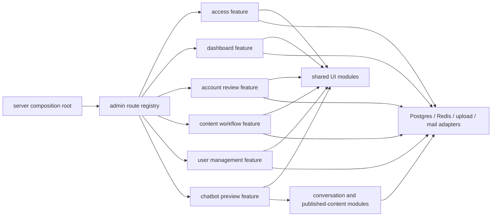

# AiCO Component-Driven Full-Stack Architecture Specification

**Status:** Proposed  
**Date:** 2026-09-07  
**Owner:** AiCO maintainers  
**Current source baseline:** Commit `63d07fc`; 200/200 tests passing. The user's separately staged `aico_demo_v3.html` is outside this refactor  
**Supersedes:** Architecture and implementation-structure guidance in earlier admin UI specs; their product workflows, visual direction, and security requirements remain authoritative  
**Implementation gate:** Production-code refactoring starts only after this specification and its companion plan are accepted.

## Decision Summary

AiCO will adopt **Component-Driven Development** as the development workflow and a **component-based, feature-oriented architecture** as the resulting structure.

The first refactor will keep the existing Node.js 24, CommonJS, native HTTP, and server-rendered HTML runtime. It will not introduce React, Vite, a client-side router, or a second application. Reusable server-rendered UI components, feature-owned page compositions, and progressively enhanced client controllers are sufficient for the current product and preserve the existing deployment and security model.

The full-stack organizing rule is:

> Shared UI modules own reusable presentation behavior. Feature modules own a complete user capability from HTTP route through application logic, persistence calls, view-model mapping, and page composition.

The refactor will use a strangler migration. Existing URLs, response codes, role gates, CSRF behavior, database schema, Redis semantics, Messenger behavior, and exported compatibility entry points remain stable while one feature at a time moves behind the new seams.

## Why This Refactor Is Needed

Recent work repeatedly changes the same files:

- `src/layout.js` is a 974-line document renderer, navigation renderer, design-token store, global stylesheet, and responsive layout implementation.
- `src/adminViews.js` is a 963-line collection of shared UI fragments, full pages, workflow-specific forms, comparison logic, and two client-script renderers.
- `src/admin/routes/handlers.js` is a 1,704-line module containing authentication support, authorization responses, SQL queries, validation, transactions, uploads, publication, notifications, cache work, view assembly, and redirects.
- Route families in `src/admin/routes/` are separated by URL area, but most behavior still leaks back into the central `handlers.js` module.
- Tests provide a strong safety net, but many view tests assert directly on incidental class names and monolithic renderer output.

The result is low locality: changing one workflow often requires editing layout, views, the shared handler module, a route family, and broad tests. `adminViews.js` has a wide, mixed-responsibility interface. `pageLayout` itself has a small interface, but its implementation has poor locality because unrelated feature CSS and shell behavior change together.

The baseline on 2026-09-07 is healthy: all 200 tests pass. This refactor must preserve that behavior continuously.

## Goals

- Make reusable UI states the starting point for admin-interface work.
- Give every shared UI component a small, documented interface and isolated tests.
- Give every user capability one feature module with a small route interface and high internal locality.
- Separate transport, application decisions, persistence, view-model construction, and rendering without creating pass-through files.
- Preserve server rendering, progressive enhancement, and low operational complexity.
- Preserve security behavior, especially output escaping, CSRF checks, role checks, upload validation, CSP, and generic production errors.
- Make pages visually consistent through shared tokens and component states.
- Let tests exercise durable interfaces instead of implementation details.
- Allow migration in small, reversible slices with no flag day.

## Non-Goals

- A React, Next.js, Vite, SPA, or hydration migration.
- A redesign of the database schema.
- A behavioral rewrite of the Messenger webhook or conversation engine. Their current behavior may move behind smaller interfaces late in the migration.
- New admin capabilities or changed business rules.
- New routes, labels, or navigation information architecture except where required for an internal development-only component catalog.
- A repository interface for every SQL statement. A seam is introduced only where production and test adapters already justify it or where behavior truly varies.
- One source file per tiny element. File count is not a measure of component quality.
- Pixel-level visual redesign during structural migration.

## Architecture Vocabulary

This specification uses the following terms precisely:

- **UI component:** a reusable rendering function with a named data contract, semantic HTML output, owned visual states, and no database or HTTP knowledge.
- **Page composition:** a feature-owned renderer that composes UI components for one screen.
- **Feature module:** a deep module that owns one user capability and exposes one small route interface while hiding queries, commands, mapping, and page composition.
- **Interface:** everything a caller must know, including inputs, outputs, invariants, errors, and side effects.
- **Seam:** the place where behavior can vary without editing the caller.
- **Adapter:** an implementation supplied at a seam, such as PostgreSQL in production or the existing fake pool in tests.
- **View model:** already-normalized, presentation-ready data. It contains no database row naming accidents and no untrusted HTML.
- **Locality:** feature knowledge and verification remain together.
- **Leverage:** one small shared interface serves multiple pages and tests.

## Chosen Approach

### Keep server-rendered function components

UI components remain plain CommonJS functions. They render HTML on the server and compose other trusted UI fragments. This fits the current runtime, requires no browser framework, keeps first response rendering fast, and avoids a new build pipeline.

### Organize full-stack behavior by feature

The existing route-family split is the starting seam. Each route family will become a feature module and absorb its relevant handlers, SQL, view-model mapping, page compositions, and feature-specific client behavior. The public interface of each feature remains one `handle...Routes(context)` function.

### Build shared UI from real consumers

Shared UI components are extracted only when a migrated page needs them. The first two consumers prove the interface before it is generalized. A component does not become shared merely because its markup is small.

### Preserve compatibility during migration

`src/layout.js`, `src/adminViews.js`, and `src/adminRoutes.js` may temporarily re-export migrated interfaces. They must not retain duplicate implementations. Compatibility exports are deleted after all callers move.

## Alternatives Considered

### React or Vite rewrite

Rejected for this refactor. It adds a build pipeline, client runtime, hydration decisions, asset handling, and broader CSP/deployment changes without being necessary for reusable components. It also makes behavioral parity harder to prove in one migration.

### Add a server template engine

Deferred. A template engine changes syntax but does not by itself improve feature locality, safety contracts, or dependency direction. It can be reconsidered after the target module seams are working.

### Split the current large files by function only

Rejected. Moving every helper into its own file would preserve the same wide interface and reduce locality. The refactor groups behavior by cohesive UI responsibility and user capability.

## Target Dependency Direction



Dependency rules:

1. The composition root may depend on every registered feature.
2. A feature may depend on shared UI, shared HTTP/security helpers, domain modules, and injected adapters.
3. Shared UI may depend only on its rendering kernel and stable constants; it never imports a feature, database, Redis, filesystem, request, or response object.
4. Feature modules do not import another feature's internal files.
5. Database rows are mapped into view models before page composition.
6. UI components never make authorization, persistence, publication, or cache decisions.
7. The conversation engine remains independent of admin UI.

## Target Repository Shape

The exact internal filenames can evolve during implementation, but the dependency direction and public interfaces are fixed.

```text
src/
  app/
    createApplication.js        # shared local/Vercel composition factory
  admin/
    routes/
      index.js                 # actual route registry and composition module
    ui/
      html.js                  # escaping and trusted-fragment contract
      document.js              # document, shell, navigation, page header
      styles.js                # tokens, base rules, component states
      forms.js                 # fields, selects, CSRF field, form actions
      dataDisplay.js           # badges, metrics, tables, descriptions
      navigation.js            # filters and pagination
      feedback.js              # notices, errors, empty states
      overlays.js              # review dialog/panel patterns
      index.js                 # intentionally small public UI interface
    features/
      access/
        routes.js
        actions.js
        pages.js
      dashboard/
        routes.js
        queries.js
        pages.js
      accountRequests/
        routes.js
        queries.js
        commands.js
        pages.js
      content/
        routes.js
        queries.js
        commands.js
        viewModels.js
        pages.js
        client.js
      users/
        routes.js
        queries.js
        commands.js
        pages.js
      chatbotPreview/
        routes.js
        pages.js
        client.js
    shared/
      guards.js                # session, role, and CSRF orchestration
      responses.js             # feature-neutral admin HTML responses
  layout.js                    # temporary compatibility export, then removed
  adminViews.js                # temporary compatibility export, then removed
  adminRoutes.js               # stable compatibility entry point
  chatbot/
    contracts.js               # session, turn-result, and reply contracts
    conversation.js            # pure conversation decisions
    publishedCatalog.js        # validated published reads and refresh policy
    messenger/
      routes.js                # webhook HTTP adapter
      eventProcessor.js        # deduplication, ordering, sends, analytics
  infrastructure/
    postgres.js                # PostgreSQL adapter construction
    redis.js                   # Redis adapter construction
    messenger.js               # Meta send adapter
  server.js                    # temporary compatibility entry point, then thin runtime start
```

Internal files may be combined when splitting would produce shallow pass-through modules. For example, a small feature can keep queries and commands inside `routes.js` until there is enough behavior to justify an internal seam.

## Rendering Contract

### Trusted fragments

The rendering kernel must make the difference between text and markup explicit.

- Values are escaped by default.
- Only UI renderers can create trusted HTML fragments.
- Nested trusted fragments can be composed without double escaping.
- Raw database values, query parameters, notice text, filenames, and user fields cannot be marked trusted at feature call sites.
- URL-bearing components accept same-document fragments (`#target`), same-origin paths with optional query/fragment (`/path?key=value#target`), or validated external HTTP(S) URLs. Protocol-relative URLs and arbitrary URI schemes are rejected.
- A final response renderer serializes the trusted fragment to a string.

The migration must keep `escapeHtml` behavior until equivalent tests prove the new rendering kernel. Security cannot depend on reviewers remembering which interpolation needs escaping.

### UI component interface

Every shared UI component must have:

- A named props object rather than positional arguments.
- Required, optional, and default states documented in its test.
- Semantic HTML and keyboard behavior.
- Empty, loading, disabled, error, and long-content behavior where applicable.
- No global mutable state.
- No feature-specific copy or SQL-shaped field names.
- A trusted-fragment return value.

### Page composition interface

A page composition accepts only:

- An authenticated actor or anonymous session summary.
- A feature-owned view model.
- Route-safe action and navigation URLs.
- Presentation state such as notice or selected filters.

It does not accept a pool, Redis client, request, response, or raw query result.

## UI Component Taxonomy

The taxonomy is deliberately small. It avoids a generic dumping ground and avoids one-file-per-tag fragmentation.

| Module           | Examples                                                   | Responsibility                                |
| ---------------- | ---------------------------------------------------------- | --------------------------------------------- |
| Rendering kernel | trusted fragment, escaped text, safe attributes            | Make composition safe by default              |
| Foundations      | tokens, typography, focus, spacing, responsive rules       | Establish shared visual invariants            |
| Shell            | document, sidebar, role navigation, page header            | Frame every admin page                        |
| Forms            | field, select, textarea, CSRF field, action row            | Render consistent accessible input controls   |
| Data display     | status badge, metric, table, description list, comparison  | Present read-only and queue data              |
| Navigation       | filter bar, pagination, action links                       | Move through list and workflow state          |
| Feedback         | notice, validation summary, empty state, unavailable state | Explain system state and recovery             |
| Overlays/actions | review panel, confirmation panel, decision group           | Contain focused workflow decisions            |
| Feature pages    | dashboard, submissions, review detail, user management     | Compose shared UI around a feature view model |

## Styling Contract

- Keep the current SLSU green/gold design language and existing semantic colors.
- Keep tokens centralized and name them by purpose rather than page.
- Organize CSS by foundations, shell, shared components, feature exceptions, and responsive states.
- A shared component owns its selectors and variants.
- `styles.js` is an entry point that composes module-owned style sections; it must not become a renamed 800-line global stylesheet.
- Avoid broad element selectors for feature styling. A feature or shared component must provide the owning class hook.
- Feature pages may add layout selectors but may not redefine global tokens or base controls.
- Avoid inline `style` attributes and user-influenced CSS.
- Preserve the current single-response inline stylesheet during the first migration. External asset extraction is a separate decision because it affects Vercel packaging, caching, and CSP.
- Keep motion optional and honor `prefers-reduced-motion` if motion is introduced later.

## Client Behavior Contract

- Server-rendered HTML is the baseline; JavaScript enhances a working document where practical.
- Each interactive feature owns one small client controller and selects elements through stable `data-*` hooks or documented IDs.
- Client controllers do not depend on presentation class names.
- User-provided data is assigned through DOM text properties, never interpolated into executable script.
- Fetch actions keep current authentication, CSRF, abort, stale-response, and error behavior.
- No site-wide client state store is introduced.

## Full-Stack Feature Interfaces

Each feature exposes a single route-family handler:

```text
handleFeatureRoutes(context) -> Promise<boolean>
```

`true` means the feature handled the route; `false` means the route registry should continue. Internally, a feature may use:

```text
request -> guard -> parser -> command/query -> view-model mapper -> page composition -> response
```

For mutations:

```text
request -> role + CSRF -> parse + validate -> transaction -> side effects -> 303 redirect
```

Feature invariants remain explicit:

- Access: login cookies contain signed identifiers, Redis stores sanitized user data, and login throttling remains unchanged; public account requests preserve their existing validation behavior.
- Account review: role assignment, office assignment, temporary password, and decision note rules remain atomic.
- Content: pending or rejected versions never enter published chatbot reads.
- Publication: database transaction completes before cache invalidation/warming and notification.
- Uploads: type, size, path, ownership, and linked-record checks run before persistence.
- Chatbot preview: it uses the same conversation engine and published-content loader as Messenger.
- User management: only admins can activate, deactivate, or assign accounts.

The chatbot side exposes equally small interfaces:

```text
runConversationTurn({ session, input, catalog }) -> { session, replies, analytics }
loadPublishedCatalog() -> { services, faqs }
handleMessengerRoutes(context) -> Promise<boolean>
```

The file-backed seed catalog, PostgreSQL published catalog, Redis cache, browser preview, and Messenger transport are adapters around those interfaces. The pure conversation implementation must not load the filesystem implicitly. Preview and Messenger must share one versioned session contract rather than duplicating allowed states.

## Component Catalog

Component-Driven Development needs an isolated feedback loop. AiCO will add a development-only catalog generated by `scripts/render-admin-ui-catalog.js`.

- It renders shared components and important variants using deterministic fixture data.
- It writes to ignored `tmp/admin-ui-catalog.html` and is never exposed as a production route.
- It includes anonymous, office-user, and admin shell states.
- It includes normal, empty, long-content, validation, disabled, destructive, and mobile-width review states.
- It contains no production credentials or database data.
- It supports visual review without adding Storybook or a frontend build system.

## Testing Strategy

The current test surface uses native `node:test` with no DOM, browser, accessibility, or visual-regression dependency. Baseline native coverage is 89.83% lines, 75.49% branches, and 88.54% functions. The migration must not reduce those whole-project baselines; new rendering-kernel and shared-UI modules require higher targeted coverage because their interfaces concentrate security and reuse.

### Rendering-kernel tests

- Escaping, trusted-fragment composition, safe attributes, and URL policy.
- Injection payloads in text, attributes, notices, table cells, and form values.

### Shared UI contract tests

- Semantic roles, labels, `aria-*` relationships, focus targets, disabled states, and stable behavior hooks.
- Important variants and empty states.
- Tests prefer observable semantics and safety over exact whitespace or full-page snapshots.

### Feature tests

- HTTP-level tests remain the primary feature interface tests.
- Existing fake PostgreSQL and Redis adapters stay available.
- Tests assert status, redirect, query/transaction outcomes, role/CSRF behavior, and user-visible output.
- Tests do not import feature internals unless an internal seam contains substantial pure behavior.

### Architecture tests

- Feature modules cannot import another feature's internal path.
- Shared UI cannot import database, Redis, upload, auth, HTTP request/response, or feature modules.
- Compatibility files contain re-exports only while they exist.
- New page compositions live with their feature, not in `src/adminViews.js`.

### Visual verification

For each migrated page, verify desktop, tablet, and narrow mobile layouts; keyboard navigation; visible focus; long content; empty state; and destructive-action clarity. The final migration gate includes the login, request-account, both dashboards, submissions, account queue, content queue/detail/history, user management, process/content forms, and chatbot preview.

## Migration Rules

1. Characterize current behavior before moving it.
2. Move one vertical feature slice at a time.
3. Extract only the shared UI required by that slice.
4. Preserve the old import through a compatibility re-export when needed.
5. Move tests to the new interface in the same change.
6. Delete the old implementation in the same change; do not keep parallel behavior.
7. Run targeted tests, then all tests, before the slice is complete.
8. Do not mix visual redesign or new product behavior into a structural migration commit.

## Migration Order

1. Rendering kernel and architecture tests.
2. Access feature as the low-risk pilot: login and public account request exercise the document, notices, and forms.
3. Shell and component catalog, derived from the pilot rather than designed speculatively.
4. Dashboard and office submissions: metrics, filters, tables, status, pagination, and role-aware shell.
5. Account review and user management: overlays, decision forms, authorization, and write actions.
6. Content workflow: complex forms, uploads, review comparison, transactions, publication, cache, and notifications.
7. Chatbot preview: interactive controller and shared conversation seam.
8. Published catalog and Messenger adapter: centralize session/result contracts, cache refresh policy, event processing, and explicit catalog injection.
9. Runtime composition: share dependency wiring between local startup and `api/index.js`.
10. Remove compatibility modules and enforce the final dependency rules.

## Compatibility And Rollback

- Public and admin URLs remain unchanged.
- Form field names, HTTP methods, status codes, redirects, and query-string notices remain unchanged unless separately specified.
- Existing semantic landmarks, CSS classes, element IDs, client behavior hooks, and script endpoint URLs remain stable during extraction-only phases; intentional markup changes require a separate reviewed change.
- `createAdminRouteHandler` remains the server-facing interface.
- Compatibility exports let a single feature migration be reverted without reverting unrelated features.
- Database migrations are not part of this refactor, so rollback is code-only.
- Each phase must be independently deployable.
- If a phase changes generated HTML intentionally, its test and visual evidence ship in the same change.
- Compatibility facades remain through at least one successful stabilization deployment before deletion.

## Acceptance Criteria

The refactor is complete when:

- All existing behavior remains covered and the full suite passes.
- `src/layout.js` and `src/adminViews.js` are removed or contain compatibility re-exports only, then are removed after callers migrate.
- `src/admin/routes/handlers.js` is removed; each handler lives with its owning feature.
- `src/server.js` is a thin composition/startup module; Messenger event processing lives in its feature module.
- Local startup and `api/index.js` use the same application factory.
- Every admin page is a feature-owned page composition using shared UI modules.
- Shared UI has no database, Redis, filesystem, request, response, or feature imports.
- Feature modules expose route-family interfaces and hide their implementation details.
- All dynamic output is escaped through the rendering contract.
- Role checks, CSRF, CSP, secure cookies, upload validation, publication isolation, cache refresh behavior, and generic errors remain intact.
- The component catalog demonstrates every shared component and required state.
- Critical pages pass responsive, keyboard, and visible-focus review.
- No duplicate old/new implementation remains.

## Deferred Decisions

The following require separate evidence and approval:

- Moving the inline stylesheet to an external static asset.
- Adopting TypeScript.
- Adopting a template engine or browser framework.
- Adding Storybook, screenshot-diff infrastructure, or a browser-test dependency.
- Changing URLs, navigation information architecture, or product workflows.
- Correcting stale permissions in already-issued admin sessions.
- Distributed cross-instance ordering or cache-generation coordination on Vercel.
- Compensating deletion for files orphaned when a later database write fails.

## Deployment Constraints

- Vercel currently routes all requests through one Node function, so a new file path does not automatically become a static asset URL.
- The Docker image has no frontend build stage and installs production dependencies only.
- CSP permits same-origin scripts and inline styles; a CDN-hosted component library would be blocked.
- HTML and authenticated script responses use no-store security headers that must remain intact.
- The parity phase therefore keeps styles and client scripts as CommonJS-rendered assets behind their current application routes. External, hashed, or separately cached assets require a later deployment decision.

## Related Documents

- `docs/superpowers/specs/2026-06-02-role-based-admin-console-redesign.md`
- `docs/superpowers/specs/2026-06-09-aico-demo-dashboard-integration-design.md`
- `docs/superpowers/plans/2026-09-07-component-driven-full-stack-refactor.md`

Where an older design document describes the chatbot preview as canned or browser-only, the current live published-content implementation is the baseline and this specification supersedes that obsolete implementation detail.
